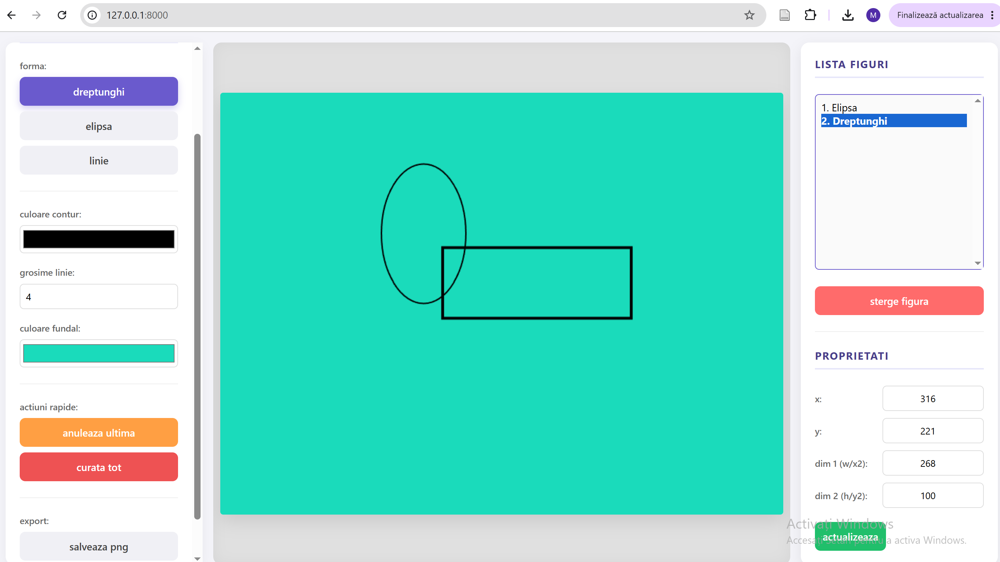

# Vanilla JavaScript Canvas Editor

A lightweight browser-based raster graphics editor built with **Vanilla JavaScript** and the **HTML5 Canvas API**.

The application allows users to draw and manage basic geometric shapes directly in the browser, edit their properties and export the final drawing as a PNG or SVG file.

## Features

- Draw rectangles, ellipses and lines
- Choose the outline color and line thickness
- Change the canvas background color
- Select and manage created shapes from a list
- Edit the position and dimensions of a selected shape
- Delete individual shapes
- Undo the last drawing action
- Clear the entire canvas
- Export the drawing as PNG
- Export the drawing as SVG

## Technologies

- HTML5
- CSS3
- Vanilla JavaScript
- HTML5 Canvas API

## Object-oriented design

The drawing logic is organized around a base `Forma` class and specialized shape classes:

- `Dreptunghi` — rectangle
- `Elipsa` — ellipse
- `Linie` — line

Each shape stores its own position, dimensions, color and line thickness, and implements its own drawing behavior on the canvas.

## Running the project

This is a static frontend project and does not require a backend or a package manager.

### Option 1: Open directly in a browser

Open `index.html` in a modern browser.

### Option 2: Use a local development server

If Visual Studio Code is installed, the project can be opened with the Live Server extension. Start the server from the project folder and open the local URL provided by the extension.

## Project structure

```text
vanilla-js-canvas-editor/
├── media/
│   └── logo.jpg
├── app.js       # Drawing logic and user interactions
├── index.html   # Application layout and controls
├── style.css    # Application styling
└── README.md
```

## How to use it

1. Select a drawing tool: rectangle, ellipse or line.
2. Choose the outline color and line thickness.
3. Draw on the canvas using the mouse.
4. Select a shape from the list to edit or delete it.
5. Use the export buttons to save the drawing as PNG or SVG.

## Possible future improvements

- Add support for touch and pointer events
- Add redo functionality
- Add image import
- Add shape rotation and resizing handles
- Add persistent projects using local storage
- Improve responsive behavior for smaller screens

## Screenshot



